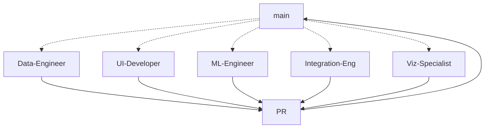

# Inflation Risk Forecasting

Streamlit + Machine Learning app to forecast inflation risk using Cambodia inflation data (2005–2025).

- **Dataset:** `data/raw/Cambodia'sInflationRate2005-2025.csv`
- **Deadline:** Nov 18, 2026
- **Deploy target:** Streamlit Community Cloud (`main` branch)

## Team Work Flow

**`main` = the real project.** Only reviewed, working code lives here. It is what gets deployed (Streamlit Community Cloud → live preview URL).

The other 5 branches are **separate experiment sandboxes** — each member's own workspace. They are *not* the real project. Never commit directly to `main` from a sandbox branch; always go through a PR.



**Flow:** each sandbox branch → **PR** (pull request) → review → merge → `main`.

**Branch map (short labels above → full branch names):**

| Label | Full branch name |
|---|---|
| `main` | `main` — the real project, live preview / deployed |
| `DE` | `Data-Engineer` |
| `UI` | `Streamlit-UI-Developer` |
| `ML` | `Machine-Learning-Engineer` |
| `IN` | `Streamlit-Integration-Engineer` |
| `VS` | `Visualization-Specialist` |

**The rules in one line:**

1. **`main`** → live preview / deployed app. Don't break it.
2. **Your role branch** → experiment, test, play around. It's yours.
3. **To land your work:** open a **PR** from your branch → `main`, get a quick review, merge. Only then does it become real.
4. **Sync daily:** `git fetch origin && git rebase origin/main` (or merge) so your branch doesn't drift. Rebase before you push/PR.
5. **Keep `ARCHITECTURE.md` updated** when you change paths, column names, feature order, widget names, or output schemas — in the same PR.

**Don't be the idiot who changes random things.** If it's not in `ARCHITECTURE.md`, don't touch it without a PR first.

## Project schedule (WBS)

| Role | Dates | Key output |
|---|---|---|
| Data Engineer | Nov 13–14 | Cleaned/lagged features, chronological train/test split → `data/processed/` |
| Streamlit UI Developer | Nov 13–14 | `app.py` skeleton, sidebar widgets, layout placeholders |
| Machine Learning Engineer | Nov 15 | Baseline model + metrics → `models/model.pkl`, feature spec |
| Streamlit Integration Engineer | Nov 16 | Wire widgets → model → predictions |
| Visualization Specialist | Nov 17 | Altair charts (history + forecast, risk thresholds) in app |
| Entire Team | Nov 18 | Cleanup, pinned `requirements.txt`, deploy `main`, smoke test |

## Quick start (local)

```bash
# clone
git clone https://github.com/Bunleang-Ea/Inflation-Risk-Forecasting.git
cd Inflation-Risk-Forecasting

# (after requirements.txt exists)
pip install -r requirements.txt
streamlit run app.py
```

## Repo structure (target)

```
app.py
data/raw/                  # source CSV
data/processed/            # train.csv, test.csv
models/                    # model.pkl
ARCHITECTURE.md            # architecture & interface contract
CONTRIBUTING.md            # workflow rules
requirements.txt           # pinned deps (for deploy)
```
